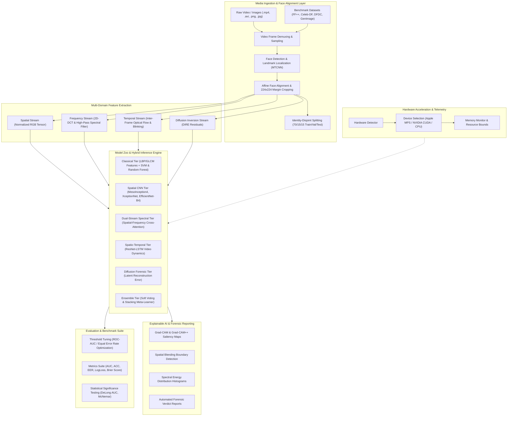

# System Architecture: DeepFake-AI Platform

## 1. High-Level System Architecture

DeepFake-AI is designed as an enterprise-grade, multi-domain forensic verification and deepfake detection platform. It ingests raw image and video streams, isolates facial regions, extracts multi-domain representations (spatial, frequency, spatio-temporal), and evaluates them through a hierarchical multi-tier model ensemble.

---

## 2. Core Architectural Components

### 2.1 Ingestion & Face Preprocessing
- **Frame Demuxer**: Decodes video streams with configurable temporal stride ($k=2$ or $4$) to balance speed and temporal resolution.
- **Landmark-Based Affine Warping**: Aligns the eye centers horizontally to normalize pose variation.
- **Identity-Disjoint Guard**: Strict splitting ensuring no actor identities cross train/val/test partitions.

### 2.2 Forensic Multi-Domain Feature Extraction
- **Spatial RGB Tensor**: Normalized using ImageNet statistics ($\mu = [0.485, 0.456, 0.406]$, $\sigma = [0.229, 0.224, 0.225]$).
- **2D-DCT Spectral Map**: Decomposes spatial image blocks into 64 frequency channels; high-frequency components are isolated via an octave high-pass mask.
- **Temporal Sequence Tensor**: Sequences of $T=16$ consecutive aligned face frames feeding recurrence and 3D convolutions.

### 2.3 Model Zoo Tiering
- **Tier 1 (Classical Forensics)**: Fast CPU inference utilizing LBP and GLCM texture statistics.
- **Tier 2 (Spatial Deep Learning)**: MesoNet and XceptionNet focusing on intra-frame boundary and blending seams.
- **Tier 3 (Dual-Stream Cross-Attention)**: Fuses spatial semantics with frequency fingerprints.
- **Tier 4 (Spatio-Temporal)**: Detects unnatural temporal jitter, eyelid freezing, and lip-sync anomalies.
- **Tier 5 (Ensemble)**: Calibrated weighted average delivering SOTA generalization across unseen generators.
